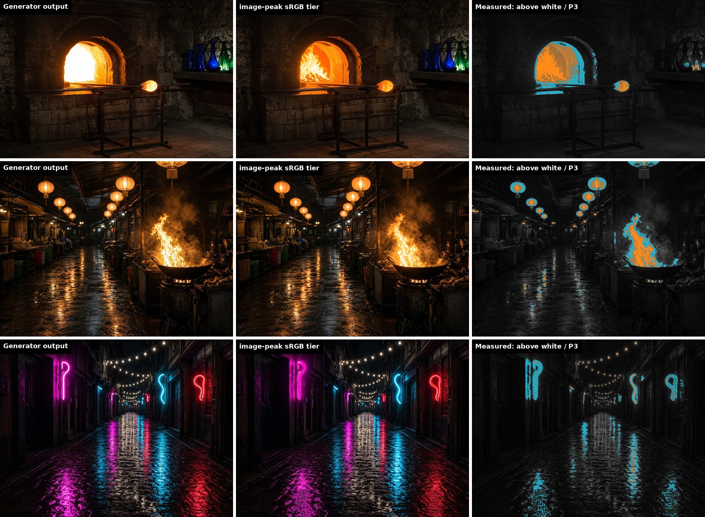

# image-peak

**One prompt, or an existing site's images, to verified HDR, Display P3 and sRGB web images, with any image generator.**

[](LICENSE)
[](#install)
[](docs/how-it-works.md)
[](docs/delivery.md)

Image generators hand you an 8-bit sRGB picture: no colour profile, nothing brighter than white, and
the brightest parts (fire, sun, neon, snow) clipped flat. image-peak keeps the generator's picture
and adds what it cannot give you: real highlight range and wide-gamut colour, delivered as three files
so every screen gets the best version it can show, from one `<picture>` element.



*Left: what the generator made. Middle: the sRGB file image-peak ships to ordinary screens, with the
fire's detail recovered instead of a white blob. Right: measured from the decoded files, orange where the
HDR file goes brighter than white (brighter orange, more headroom), cyan where the P3 file holds colour
sRGB cannot show.*

**The story behind it:** [The colour you mostly won't see](https://fauzul.com/blog/colour-you-mostly-wont-see),
on oklch, Display P3 and HDR on today's screens, with live demos.

## What you get

| File | What it is | Who sees it |
|---|---|---|
| `name.uhdr.jpg` | Ultra HDR JPEG: an sRGB picture plus a gain map that lifts highlights and widens colour | HDR screens in Chromium browsers and Safari 26; the OS scales the lift to the screen's live headroom |
| `name.p3.jpg` | SDR JPEG in Display P3 | Wide-gamut screens not showing HDR |
| `name.sdr.jpg` | SDR JPEG in sRGB, highlight detail kept | Everyone else |
| `name.picture.html` | The `<picture>` element that picks between them | Paste into your page |
| `preview.html` | Slider comparing the generator output with each file, plus the full report | You, before shipping |

Every file is decoded again and checked before a run reports success (8 checks: alignment, gain map
present, decoded peak, decode error, base fidelity, P3 profile, P3 fidelity, no new blown pixels).

## Results

Five scenes, two generator images each (a base and an edit of it about 4 stops darker), built by this
repo's code. All files are in [`examples/`](examples/). Numbers come from each run's report.

| Scene | HDR peak | Pixels above white | P3 file: colour outside sRGB | Blown to white, generator → sRGB file | Sizes (HDR / P3 / sRGB) | Checks |
|---|---|---|---|---|---|---|
| [Glass furnace](examples/glass-furnace) | 7.85× | 3.9% | 6.5% | 2.20% → 0.00% | 265 / 163 / 164 KB | 8/8 |
| [Night market](examples/night-market) | 7.28× | 2.6% | 6.4% | 0.02% → 0.02% | 409 / 227 / 229 KB | 8/8 |
| [Neon alley](examples/neon-alley) | 3.58× | 0.4% | 8.4% | 0.00% → 0.00% | 522 / 249 / 252 KB | 8/8 |
| [Snow peak](examples/snow-peak) | 3.80× | 6.4% | 0.3% | 2.02% → 0.20% | 363 / 205 / 206 KB | 8/8 |
| [Lighthouse at dusk](examples/lighthouse-dusk) | 2.28× | 0.3% | 0.5% | 0.00% → 0.00% | 274 / 188 / 189 KB | 8/8 |

Light sources (fire, lamps) earn the most HDR; saturated colour (neon) earns the P3 file; a low-key dusk
scene earns little of either, and the report says so. Per-scene figures and notes: [docs/results.md](docs/results.md).

## Install

Needs only Python 3.10+ (or [uv](https://docs.astral.sh/uv/)), on macOS, Linux, WSL or native Windows.
There is no setup step: the first run of any command builds its own environment in `~/.venvs/image-peak`
(about a minute, once; nothing compiles) and carries on. Pick the route for your agent.

**Any agent harness or terminal** (Codex, Cursor, Gemini CLI, Windsurf, your own):

```bash
curl -fsSL https://raw.githubusercontent.com/fauzulkc/image-peak/main/install.sh | bash
```

This puts an `image-peak` command on your `PATH`. Agents that read `AGENTS.md` get their instructions
from [AGENTS.md](AGENTS.md); point any other agent at it.

**Claude Code plugin** (the best route in Claude Code). In Claude Code:

```text
/plugin install image-peak --marketplace fauzulkc/image-peak
```

On Claude Code older than 2.1.275, add the marketplace first:

```text
/plugin marketplace add fauzulkc/image-peak
/plugin install image-peak@image-peak
```

From a terminal instead:

```bash
claude plugin marketplace add fauzulkc/image-peak && claude plugin install image-peak@image-peak
```

**Claude Code skill folder** (without the plugin system):

```bash
git clone https://github.com/fauzulkc/image-peak.git ~/.claude/skills/image-peak
```

**Just the code** (any OS, including Windows without WSL; use `py` if `python3` is missing):

```bash
git clone https://github.com/fauzulkc/image-peak.git && cd image-peak
```

Use one Claude Code route, not both, or the skill shows up twice. Details and troubleshooting:
[docs/getting-started.md](docs/getting-started.md).

## Use it from an agent

Ask in plain words. In Claude Code the skill loads itself; in other harnesses, say "use image-peak" or
point the agent at `AGENTS.md`. The agent runs every step, including the one-time setup:

```text
Make a hero image of a glass furnace with image-peak: HDR and P3, generated with Cursor.
```

```text
Audit this site's images with image-peak and upgrade the ones that would gain from HDR or P3.
```

```text
Turn the photo in public/images/sunset.jpg into image-peak tiers.
```

## Use it from a terminal

Every command below runs from the repo folder. `python3 scripts/image_peak.py` is the one entry point
(`image-peak` if you used the installer; `py scripts\image_peak.py` on Windows).

**Try it in a minute, no generator needed:** rebuild an example from its saved frames and open the preview.

```bash
python3 scripts/image_peak.py build --slug night-market --out examples
python3 -m http.server 8000 --directory examples
```

Then open <http://localhost:8000/night-market/preview.html>.

**One prompt with a generator CLI** (adapters for Cursor's `agent` and Antigravity's `agy` are bundled; any other generator plugs in through a [two-command adapter](docs/generators.md)):

```bash
python3 scripts/image_peak.py run "a filament bulb glowing at dusk on a wooden desk" --slug bulb --out ./images --generator cursor
```

**Generator only an agent can call** (an MCP image tool, a harness's built-in one): `plan` prints the two
prompts and where to save each image, `build` does the rest. See [docs/generators.md](docs/generators.md).

```bash
python3 scripts/image_peak.py plan "a filament bulb glowing at dusk" --slug bulb --out ./images
python3 scripts/image_peak.py build --slug bulb --out ./images
```

**An existing site or repo:** audit, upgrade, then a reviewable `` → `<picture>` patch.

```bash
python3 scripts/image_peak.py audit   ./my-site
python3 scripts/image_peak.py upgrade ./my-site --generator cursor
python3 scripts/image_peak.py rewrite ./my-site
```

`audit` changes nothing; `upgrade` writes new files beside each original at its exact size and never
touches the originals; `rewrite` writes `markup.patch` and applies it only with `--apply`. A worked example
with its recorded output: [examples/site-upgrade](examples/site-upgrade). Full walkthrough:
[docs/site-upgrade.md](docs/site-upgrade.md).

## Put it on a page

```html
<picture>
  <source media="(dynamic-range: high)" srcset="bulb.uhdr.jpg">
  <source media="(color-gamut: p3)" srcset="bulb.p3.jpg">
  
</picture>
```

```css
img { dynamic-range-limit: standard; }          /* calm HDR in grids and body copy */
.hero img { dynamic-range-limit: no-limit; }    /* full HDR where the image is the point */
```

Every file holds a correct SDR picture, so a wrong guess still shows a good image. **Never pass these
files through an image optimizer or a CDN that re-encodes JPEGs**: re-saving strips the gain map and the
P3 profile. `audit` lists the steps in your build that would. More: [docs/delivery.md](docs/delivery.md).

## How it works

1. The generator makes the picture, then edits that same picture about 4 stops darker, so the bright
   parts show colour and texture. An edit, never a second generation: a second generation is a
   different scene.
2. The code aligns the two, builds an HDR master (the base everywhere; highlights lifted with shape and
   colour from the dark edit), tone-maps an sRGB file that keeps highlight detail, expands
   already-saturated colour into P3, and encodes everything with libultrahdr.
3. Every file is decoded and checked. A run that fails a check exits non-zero and names the check.

A generator that cannot edit still works in single-frame mode (highlights lifted from the one image).
Real camera brackets work too, and give captured rather than authored range. Full detail:
[docs/how-it-works.md](docs/how-it-works.md).

## Be honest about what it is

- Highlights and P3 colour built from a generator are **authored, not captured**: the generator invents
  what a darker exposure shows, and its "4 stops darker" is really 0.4 to 2 stops and uneven, so the HDR
  level is set by a chosen headroom. Say so where it matters.
- Output size is the generator's (about 1,000 to 1,300 px wide). Upscale the frames before building a hero.
- HDR is proven by decoded numbers until someone looks on an HDR screen. The examples were checked by
  decoding; view `preview.html` on an HDR display in Chrome or Safari to see the real thing.

## Documentation

| Page | Covers |
|---|---|
| [Getting started](docs/getting-started.md) | Install routes, requirements, first run, troubleshooting |
| [AGENTS.md](AGENTS.md) | Instructions for any agent harness: routes, commands, exit codes, rules |
| [Usage](docs/usage.md) | Every command, flag, output file and exit code |
| [Generators](docs/generators.md) | Cursor, agy, writing an adapter, agent-driven tools |
| [Upgrading a site](docs/site-upgrade.md) | audit, upgrade, rewrite, pipeline risks |
| [How it works](docs/how-it-works.md) | Alignment, headroom, HDR master, tone mapping, P3, checks |
| [Delivery](docs/delivery.md) | `<picture>`, `dynamic-range-limit`, keeping files intact |
| [Results](docs/results.md) | All five scenes with figures and notes |
| [Changelog](CHANGELOG.md) | Versions |

## License

[MIT](LICENSE) © Fauzul Chowdhury. Uses [libultrahdr](https://github.com/google/libultrahdr) through
[imagecodecs](https://github.com/cgohlke/imagecodecs).
