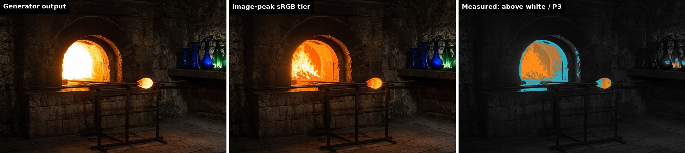
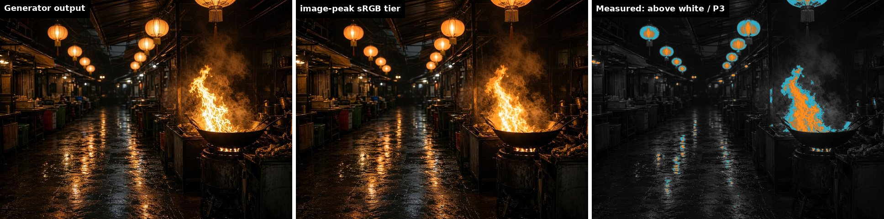
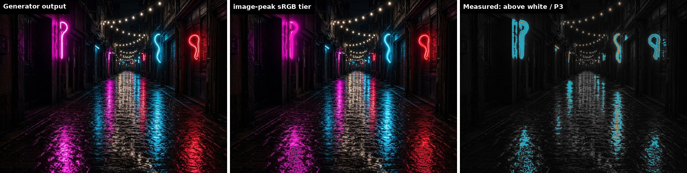
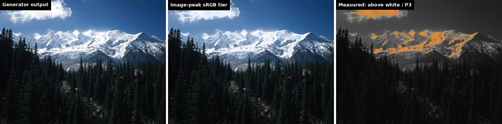
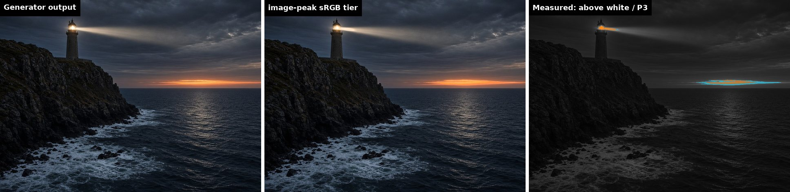

# Results

Five scenes. Each started as two images from Cursor's built-in generator (a base and an edit of it about
4 stops darker) and was built by this repo's code. Every number below comes from the scene's
`report.json` in [`examples/`](../examples); all 8 checks passed on all five. The figures show the
generator's picture, the sRGB file true-image ships, and a map measured from the decoded files: orange
where the HDR file goes above SDR white (brighter orange, more headroom), cyan where the P3 file holds
colour outside sRGB.

| Scene | Size | Clipped in generator output | Headroom chosen | HDR peak | Above white | P3 file outside sRGB | Blown, generator → sRGB file | HDR / P3 / sRGB |
|---|---|---|---|---|---|---|---|---|
| Glass furnace | 1048×712 | 5.3% | 8× (light sources) | 7.85× | 3.9% | 6.5% | 2.20% → 0.00% | 265 / 163 / 164 KB |
| Night market | 1078×812 | 3.6% | 8× (light sources) | 7.28× | 2.6% | 6.4% | 0.02% → 0.02% | 409 / 227 / 229 KB |
| Neon alley | 1042×794 | 0.8% | 8× (light sources) | 3.58× | 0.4% | 8.4% | 0.00% → 0.00% | 522 / 249 / 252 KB |
| Snow peak | 1056×794 | 7.7% | 4× (large bright areas) | 3.80× | 6.4% | 0.3% | 2.02% → 0.20% | 363 / 205 / 206 KB |
| Lighthouse at dusk | 1042×768 | 0.5% | 8× (light sources) | 2.28× | 0.3% | 0.5% | 0.00% → 0.00% | 274 / 188 / 189 KB |

"Clipped" counts pixels near white in the generator's picture; "blown" counts pixels pure white in all
three channels.

## Glass furnace

The generator's furnace mouth is a white blob. The sRGB file shows the flames; the HDR file lifts the
fire core and the molten glass toward 8× white. The cobalt and emerald vases and the orange firelight go
into P3. The generator's darker edit measured 1.88 stops against the 4 asked for.

## Night market

The wok flames and the lanterns are the HDR; the lantern paper and the fire's orange go into P3. Almost
nothing was blown in the generator's picture (0.02%), so the sRGB file looks close to it; the gain is on
HDR and P3 screens. This scene was made from a single prompt with `run --generator cursor`.

## Neon alley

The neon tubes were already coloured in the generator's picture, so the HDR lift is modest (3.58×, 0.4% of the
picture). The P3 file is the gain here: 8.4% of the colour, the magenta, cyan and red tubes and their
reflections, sits outside sRGB.

## Snow peak

Large bright areas get a lower peak (4×) so the snowfield stays comfortable to look at. Blown pixels drop from 2.02% to
0.20% in the sRGB file, and 6.4% of the picture is lifted above white. The scene is close to neutral, so
the P3 file adds almost nothing (0.3%): on a real page, ship the HDR and sRGB files and skip P3.

## Lighthouse at dusk

A low-key scene: only the lamp clipped (0.5%), and the dark edit was just 0.39 stops darker. The HDR file
peaks at 2.28× on 0.3% of the picture and the P3 file holds 0.5%. The report makes the call easy: ship the
sRGB file alone. It is here to show the report saying no.

## Site upgrade

[`examples/site-upgrade`](../examples/site-upgrade) runs `audit`, `upgrade` and `rewrite` on a small site
with six images, four kinds of reference and three pipeline risks. Its recorded output is in
`examples/site-upgrade/results/`; the walkthrough is [site-upgrade](site-upgrade.md).

## How these were checked

By decoding every file and measuring it (the 8 checks in [how it works](how-it-works.md)), and by loading
the previews in Chromium on an sRGB screen. The HDR and P3 files were checked by decoding;
to see them, open any `examples/*/preview.html` over `http://` on an HDR or P3 screen.
